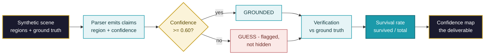
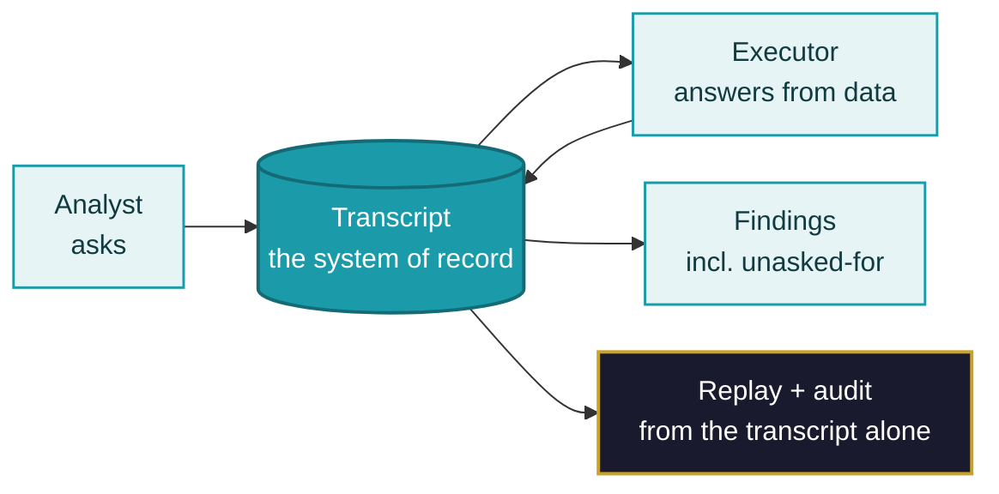
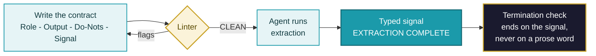
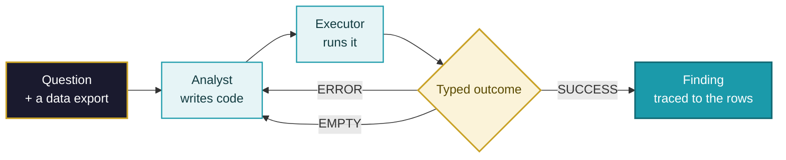
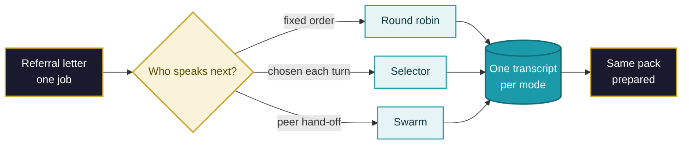
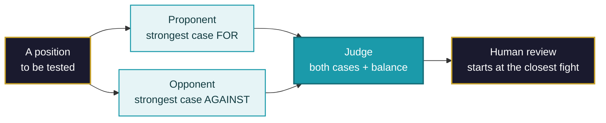

# The Business Case — POC Learning Lab
▸ GAI OBSERVE LLC · POC LEARNING LAB — executive brief, 2026-10-26
*Lean edition: the pattern, the money, the industries, the path from demo to deployment.*

## Lead with the data — the market, and the failure curve
**The market (third-party forecasts, cited — not our numbers):**
- Enterprise agentic AI: **USD 2.58B in 2024 → USD 24.5B by 2030**;
  Grand View Research states the 46.2% CAGR for 2025–2030
  (Enterprise Agentic AI Market Report, 2025–2030).
- Forecasts vary by definition and scope — Omdia's software-only
  forecast is USD 1.5B in 2025 → USD 41.8B in 2030. Treat any single
  figure as a named estimate, never as a promise.
- Adoption: Gartner (Aug 2025) predicts **40% of enterprise
  applications will feature task-specific AI agents by end of 2026**,
  up from under 5% in 2025; by 2029 at least 50% of knowledge workers
  will develop skills to work with, govern or create agents.

**The failure curve (why this lab leads with controls, not demos):**
Gartner (June 2025) also predicts **over 40% of agentic AI projects
will be canceled by end of 2027**. Gartner lists escalating costs,
unclear business value or inadequate risk controls. The patterns
below address those listed causes — a verification loop
makes value testable, a transcript-of-record is the audit trail, and
a linted contract is a pre-runtime risk control.

**Our data (separate ledger, always labelled):** everything this lab
has produced so far is ILLUSTRATIVE — scripted demonstrations over
synthetic data (see the honesty note in the patterns and
KEY-DATA-POINTS.md). Market figures are other people's, cited;
pilot figures will be ours only when a real pilot runs.

## Why this lab exists, in business terms
In our assessment, the business problem is trust: claims nobody can
trace, state nobody can audit, and behaviour nobody contracted for.
The three patterns in this lab are low-cost controls for those three
failure modes — each demonstrated by a small, runnable, public
reference implementation an executive team can inspect before it
funds anything.

**Honesty note (read first):** the Day 1 notebooks are *scripted
demonstrations over synthetic data*, labelled ILLUSTRATIVE in this
repository. Nothing here is a measured field result. What a measured
pilot looks like is specified at the end — that is the standard we sell
against, and the standard we hold ourselves to.

## Pattern 1 — Grounded perception with a verification loop (POC 01)
**The pattern:** every machine claim names its evidence region, carries
a confidence, and is checked against ground truth; the headline metric
is the *survival rate* — how many claims withstand verification.
**The money:** unverified automation is rework with a latency period.
A verification loop converts silent errors into a priced quantity: the
survival rate tells you, before scale, what fraction of output a human
must still touch.
**Where it applies:**
- Insurance & field services: photo-based claims triage, damage assessment.
- Construction & facilities: site-inspection QA, punch-list verification.
- Retail: shelf and signage audits from store photography.
- Public sector: accessibility audits of public spaces (the demo's case).

**The concept, in one diagram:**

## Pattern 2 — The transcript is the system of record (POC 02)
**The pattern:** agents coordinate only through a shared, persisted
transcript; the transcript *is* the state — replayable, auditable,
with no side channels.
**The money:** coordination failures in operations are usually
*provenance* failures — nobody can reconstruct who decided what, from
which data. A transcript-of-record collapses the reconstruction cost in
every audit, dispute and incident review, and makes agent work
supervisable by ordinary management tools.
**Where it applies:**
- Contact centres: agent-assist wrap-up, QA sampling, complaint handling.
- Finance operations: reconciliations and exception hunts with a full trail.
- Healthcare administration: multi-step case coordination under audit.
- Shared services / BPO: any workflow where the client may ask "show me".

**The concept, in one diagram:**

## Pattern 3 — Contract before capability (POC 03, RODS)
**The pattern:** no agent runs without a four-line contract — Role,
Output, Do-Nots, Signal — checked mechanically (linted) before runtime,
and terminated on a typed signal, never a prose word.
**The money:** the failure mode this pattern targets is
contract-shaped: scope the agent invented, output shapes downstream
systems could not consume, runs that never cleanly ended. A lintable
contract is a low-cost control — it costs four lines and a checker,
and it surfaces agent risk *before* deployment.
**Where it applies:**
- Telecom & utilities: regulated customer operations, SLA extraction.
- Banking & insurance: document extraction with explicit do-nots.
- Legal operations: clause and obligation extraction (the demo's case).
- Any enterprise: as the intake gate for every internal agent.

**The concept, in one diagram:**

## Pattern 4 — The error is the curriculum (POC 04)
**The pattern:** an analyst agent writes code, an executor runs it, and
every failure comes back as data the next attempt must answer. The loop
keeps a typed outcome per attempt — ERROR (the code was wrong), EMPTY
(the question was wrong) or SUCCESS — and ends on a typed signal.
**The money:** the expensive failure in analytics automation is the
*silent* wrong answer, and the second most expensive is engineers
debugging code when the question itself was malformed. Separating
ERROR from EMPTY routes each failure to the fix that actually applies,
and the recovery habits the loop teaches — print the schema before you
guess at it — are the difference between an agent that stalls and one
that self-corrects. In the demonstration, five attempts produce one
error, one empty result and three successes, and the finding (a $78.00
unused-subscription leak) is traced to the actual rows behind it.
**Where it applies:**
- Finance operations: recurring spend and exception analysis over exports.
- BI and reporting teams: self-service analytics with an audit trail.
- Data migration: reconciliation queries that must explain themselves.
- Any data team: a first-pass analyst whose work a human can replay.

**The concept, in one diagram:**

## Pattern 5 — Choose your parliament (POC 05)
**The pattern:** the same three specialists, the same job, three ways
to decide who speaks next — fixed rotation (round robin), a central
selector, and peer hand-offs (swarm). Each shape is run on the same
input and the mechanics are counted per shape: agent turns, routing
calls, hand-offs.
**The money:** coordination shape is a cost and control decision, not a
fashion choice. Rotation is predictable but spends turns re-running
the sequence; a selector pays extra routing calls to keep the path
direct; hand-offs let specialists pull work but add verification
hand-backs. Counting the mechanics on your own job — before choosing —
is what turns a framework debate into an engineering estimate. The
demonstration's counts are the mechanics of a script, not live costs;
the transferable asset is the comparison table itself, and the
transcript each shape leaves behind.
**Where it applies:**
- Contact centres: multi-specialist case handling and warm transfers.
- Healthcare administration: referral preparation across specialties (the demo's case).
- Service desks: triage where the next handler depends on the finding.
- Claims operations: intake teams that hand cases between specialists.

**The concept, in one diagram:**

## Pattern 6 — Disagreement is a sensor (POC 06)
**The pattern:** for each position, a proponent and an opponent argue
from the same evidence list, and a judge records the strongest point
each way, the verdict, and how balanced the argument was. The balance
figure is a prompt for human review — it tells reviewers where to look
first — never a decision and never a risk register.
**The money:** review time is the scarcest resource in any governance
process. A structured debate converts a one-sided summary into an
auditable record of both cases, so human reviewers spend their hour on
the closest fight instead of re-deriving the argument from scratch. In
the demonstration, three contract positions produce two REJECTs and
one PROCEED, and the closest fight (0.62 balance) is exactly the item
a reviewer should open first. A real position still requires
independent evidence and counsel review — the pattern allocates the
review, it does not replace it.
**Where it applies:**
- Contract operations: clause-by-clause review queues (the demo's case).
- Vendor and risk assessments: structured challenge before sign-off.
- Architecture boards: decision records that show both sides.
- Policy exceptions: any queue where review effort must be rationed.

**The concept, in one diagram:**

## From demonstration to deployment — the four steps
1. **Pattern fit (days):** pick the pattern, name the business owner and
   the cost line it moves. No pattern, no project.
2. **Measured pilot (weeks):** one site, one workflow, human checkers;
   the demo's illustrative metrics become measured ones (survival rate,
   findings precision, lint catch rate) against a recorded baseline.
3. **Contract & controls (weeks):** RODS contracts for every agent,
   transcript-of-record switched on, verification loop staffed.
4. **Scale decision:** expand only on the measured pilot numbers —
   the same evidence discipline this repository is published under.

## What it costs to start
The reference implementations are free (MIT / CC BY 4.0) and run
offline. The real cost of step 2 is people-time: one business owner,
one engineer, and checker hours for the verification loop. That is the
lean start: evidence first, platform spend after the numbers exist.

## Sources (market section)
- Grand View Research — Enterprise Agentic AI Market Report 2025–2030:
  https://Www.grandviewresearch.com/industry-analysis/enterprise-agentic-ai-market-report
- Gartner press release, 2025-08-26 — 40% of enterprise apps to feature
  task-specific AI agents by 2026:
  https://www.gartner.com/en/newsroom/press-releases/2025-08-26-gartner-predicts-40-percent-of-enterprise-apps-will-feature-task-specific-ai-agents-by-2026-up-from-less-than-5-percent-in-2025
- Omdia — Enterprise Agentic AI Software Market Forecast (Sep 2025):
  https://omdia.tech.informa.com/pr/2025/sep/new-omdia-analysis-shows-agentic-ai-outpacing-growth-rates-of-traditional-generative-ai
- Gartner cancellation prediction (June 2025), as widely reported.
