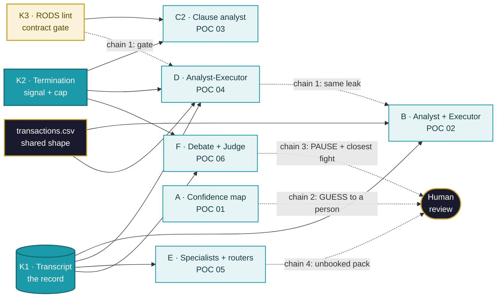

▸ GAI OBSERVE LLC · POC LEARNING LAB
# Component Catalogue and Dependency Map — POCs 01–06

*DRAFT, 2026-11-19. Every component below was read in the source file named
in its row. All Month 1 components are deterministic stubs or plain functions:
no live model runs anywhere. Mode INTERIM; figures ILLUSTRATIVE.*

## 1. Shared kit (`kit/`)

| ID | Component | File | Role | Input → Output | Used by |
|---|---|---|---|---|---|
| K1 | TranscriptStore | `kit/transcript.py` | The record every agent writes to | `append(speaker, kind, content)` → `{turn, speaker, kind, content}`; `save_jsonl(path)` writes LF JSONL | 02, 04, 05, 06 |
| K2 | Termination | `kit/termination.py` | Ends a run on an exact typed signal or a turn cap | `check(text)` → `"SIGNAL"` \| `"CAP_TURNS"` \| `None` | 03, 04, 06 |
| K3 | RODS parser + linter | `kit/rods.py` | Contract check before runtime | `parse_rods(text)` → `{Role, Output, Do-Nots, Signal}` (raises on a duplicate field); `lint_rods(c)` → list of `MISSING:<f>`, `WEAK_SIGNAL`, `VAGUE_OUTPUT` | 03 |
| K4 | SessionLog | `kit/session_log.py` | One summary row per session | `row()` → `{session_id, turns, elapsed_s, outcome}` | **none yet** — available for Innovation Week |

## 2. POC components

| ID | POC | Component | Role | Inputs | Outputs | Tools / rules | Guardrail |
|---|---|---|---|---|---|---|---|
| A1 | 01 | Scene parser (stub) | Emits region claims | `data/claims.csv` | claim rows | — | Synthetic scenes only |
| A2 | 01 | Confidence flagger | GUESS below 0.60 | claim rows | `flag` per row | `FLAG_THRESHOLD = 0.60`, fixed before the run | Guesses are flagged, never hidden |
| A3 | 01 | Human verifier (recorded) | Confirms each claim | `verified` column | survived count | Scripted in this demo | Findings are drafts until a person confirms |
| A4 | 01 | Survival summariser | Headline metric | rows | `survival_rate` | survived ÷ total | Rate is computed, never typed |
| B1 | 02 | Analyst | Asks questions | — | `question` messages | K1 | Copied export only |
| B2 | 02 | Executor (analysis functions) | Answers from data | `data/transactions.csv` | `result` messages, findings | `find_unused`, `find_count_change`, `find_overlap` | Never live bank access |
| C1 | 03 | RODS contract | The agent's whole brief | four lines of text | contract dict | K3 | Decides nothing; no legal advice |
| C2 | 03 | Clause analyst (stub) | Fixed-table extraction | `data/extraction.csv` | party \| duty \| deadline rows | K2, signal `EXTRACTION COMPLETE`, cap 10 | Output feeds a lawyer's queue |
| D1 | 04 | Analyst (scripted attempts) | Writes code per question | `ATTEMPTS` | code messages | K1 | Education, not financial advice |
| D2 | 04 | Executor | Runs code, returns result or error text | code + `rows` | `(ok, result_or_error)` | `SAFE_BUILTINS`; **not an isolation boundary** | Synthetic data only |
| D3 | 04 | Outcome classifier | Types each attempt | executor result | `ERROR` \| `EMPTY` \| `SUCCESS` | K2, signal `ANALYSIS COMPLETE`, cap 20 | Finding only from attempts that ran |
| E1 | 05 | Summariser / Matcher / Scheduler | Narrow specialists | shared `state` dict | state fields + turn text | — | Prepare and propose only |
| E2 | 05 | Round-robin router | Fixed order, twice | `ORDER` | 6 turns | — | — |
| E3 | 05 | Selector (the chair) | Picks next speaker from state | `state` | route messages | `choose_next`; cap 12 | INCOMPLETE recorded only if work remains |
| E4 | 05 | Swarm hand-off | Peers hand off directly | `state` | handoff messages | verification hand-back; cap 12 | — |
| E5 | 05 | Pack finisher | Final output | `state` | `{specialty, slots, booked: False}` | — | Booking needs human confirmation |
| F1 | 06 | Proponent / Opponent | Strongest case each way | `data/claims.csv` | `case` messages | Neither concedes | — |
| F2 | 06 | Judge | Fixed rule, stated first | totals | `PROCEED` \| `PAUSE` \| `REJECT` + strongest point each way | margin rule; K2, signal `DEBATE COMPLETE`, cap 30 | Informs counsel; never signs or advises |
| F3 | 06 | Disagreement score | Ranks review order | totals | 0–1 per claim | min ÷ max (0 if both are 0) | A prompt for review, not a risk register |

## 3. Shared contracts and data shapes

| Shape | Fields | Where | Note |
|---|---|---|---|
| Transcript message | `turn, speaker, kind, content` | K1 → 02, 04, 05, 06 | The common hand-off format. `kind` values seen: question, result, finding, signal, code, error, termination, turn, route, handoff, case, verdict |
| Transaction row | `month, category, amount` | 02 and 04 `data/transactions.csv` | Same 22 rows in both POCs; only the decimal format differs (`82.00` vs `82.0`) |
| Claim row (seeing) | `scene, region, claim, confidence, flag, verified` | 01 | `flag` in the CSV is ignored; it is re-derived |
| Claim row (debate) | `claim_id, claim, side, point, strength` | 06 | `side` is `pro` or `con` |
| Obligation row | `party, duty, deadline` | 03 | The RODS Output line names this table |
| Typed signals | `EXPLORATION COMPLETE`, `EXTRACTION COMPLETE`, `ANALYSIS COMPLETE`, `DEBATE COMPLETE` | 02, 03, 04, 06 | Exact match only. 02 does not check its signal |
| Typed outcomes | `GROUNDED/GUESS`, `CLEAN/flags`, `ERROR/EMPTY/SUCCESS`, `PROCEED/PAUSE/REJECT`, `pack prepared/INCOMPLETE` | 01, 03, 04, 06, 05 | The strings a downstream step can branch on |

## 4. Dependency map
Solid arrows: a real import or data flow in the code today. Dotted arrows: a
combination the shapes allow, exercised by `innovation-week/chains/check_chains.py`
with glue only (no POC code changed).

Read it as: the kit is the spine. K1 carries every hand-off, K2 ends every
run, K3 decides whether a run may start. POC 01 stands alone in the code today:
it shares no kit component, only the habit of typed outputs.

## 5. Gaps found while cataloguing (for the owners, not fixed here)
- **G1.** POC 02 appends `EXPLORATION COMPLETE` but never checks it with K2.
- **G2.** POC 05 specialists share a mutable `state` dict. That is shared memory, unlike POC 02's transcript-only rule. The transcript still records every turn.
- **G3.** POC 05 marks a run `pack prepared` whenever `specialty` is set. A stuck router can set `general` and look complete; only the termination record shows it failed (chain 4).
- **G4.** K4 SessionLog is in the kit but no POC uses it.
- **G5.** POC 01 does not use the kit at all.

None of these is a defect in what the POCs teach. They are the places a
learner will hit first when combining components.
