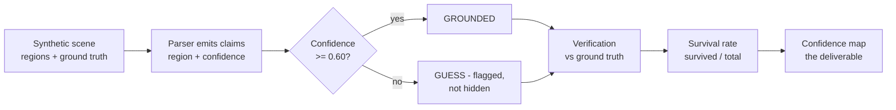
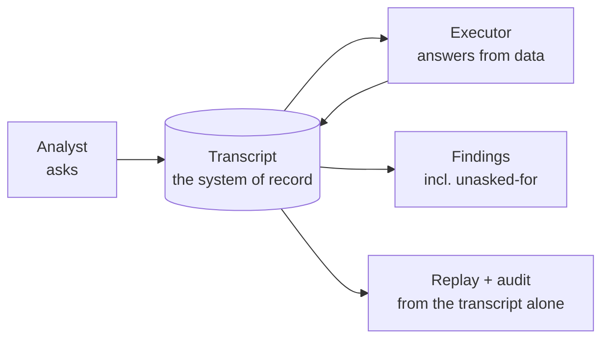
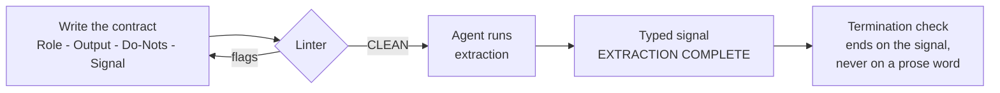

# Concept Diagrams — POC Learning Lab
▸ GAI OBSERVE LLC · POC LEARNING LAB — overview materials, 2026-10-26
*One diagram per POC: the concept on one screen. Mermaid source — renders
on GitHub, stays text in the repo (versionable, no binary drift). The
presentation deck carries rendered versions of the same three diagrams.*

## 01 · An Agent That Sees — grounded perception + verification

Read it as: a claim is never just text — it carries where it looked and
how sure it is, and the system's headline is how many claims *survive
checking*. In this demo the verification table is scripted, so the rate
illustrates the method (labelled ILLUSTRATIVE in the notebook).

## 02 · Conversation Is a Coordination Primitive — transcript as state

Read it as: there is no side channel and no shared memory — if it is
not in the transcript, it did not happen. Audit and replay are free
because the conversation *is* the state.

## 03 · RODS — contract before capability

Read it as: four lines, checked mechanically *before* the agent runs.
A contract that fails lint never executes; a run ends on a typed
signal, not on a word an agent might say by accident.
