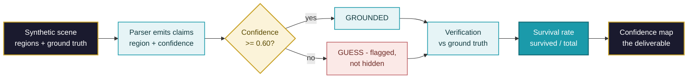
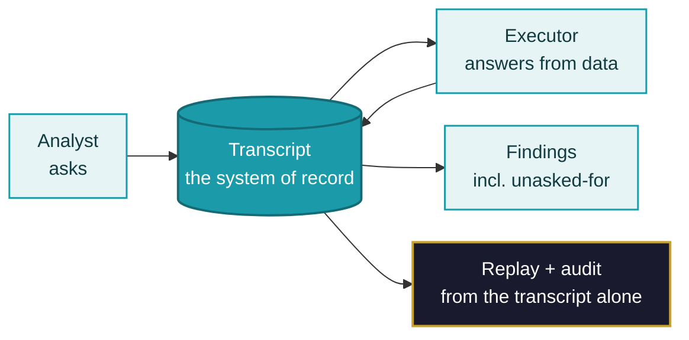
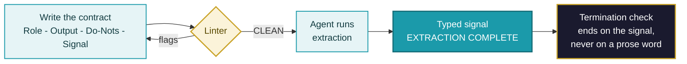
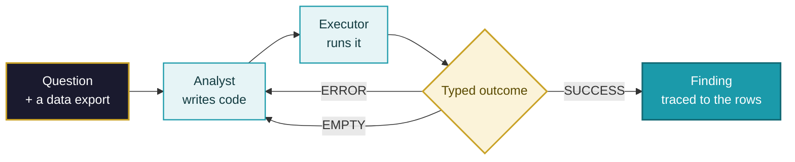
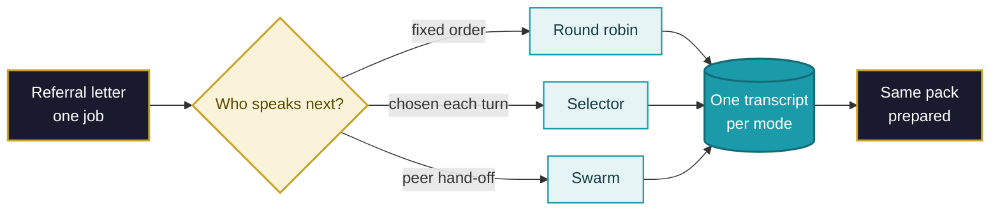
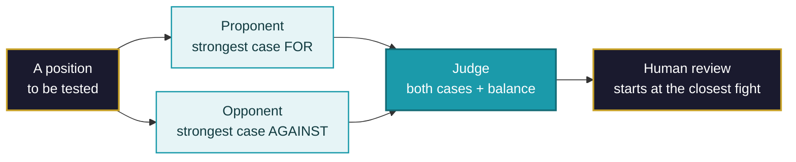

# Concept Diagrams — POC Learning Lab
▸ GAI OBSERVE LLC · POC LEARNING LAB — overview materials, 2026-10-26
*One diagram per POC: the concept on one screen. Mermaid source — renders
on GitHub, stays text in the repo (versionable, no binary drift). Palette:
navy = start/deliverable · teal = process · gold = decision · strong teal =
the headline idea · rose = the flagged path. The business deck embeds these diagrams beside
their business-case patterns; the Mermaid source here is the version
of record.*

## 01 · An Agent That Sees — grounded perception + verification

Read it as: a claim is never just text — it carries where it looked and
how sure it is, and the system's headline is how many claims *survive
checking*. In this demo the verification table is scripted, so the rate
illustrates the method (labelled ILLUSTRATIVE in the notebook).

## 02 · Conversation Is a Coordination Primitive — transcript as state

Read it as: there is no side channel and no shared memory — if it is
not in the transcript, it did not happen. Audit and replay are free
because the conversation *is* the state.

## 03 · RODS — contract before capability

Read it as: four lines, checked mechanically *before* the agent runs.
A contract that fails lint never executes; a run ends on a typed
signal, not on a word an agent might say by accident.

## 04 · The Analyst–Executor Loop — the error is the curriculum

Read it as: the failure is not the opposite of the result — it is an
input to the next attempt. ERROR means the code was wrong, EMPTY means
the question was, and the loop treats them differently; what survives
is a finding a human can trace back to the rows it came from.

## 05 · Three Ways to Run a Group Chat — choose your parliament

Read it as: the job never changes — only the parliament does. Fixed
order is predictable and spends turns; a selector pays routing calls
to stay direct; peers pull work and hand it back for verification.
Each shape leaves its own transcript, so the choice can be audited,
not just argued.

## 06 · The Debate Pattern — disagreement is a sensor

Read it as: the pattern decides nothing. It converts a one-sided
summary into a record of both cases and rations the scarcest resource
in governance — reviewer attention — to the argument that is hardest
to call. A real position still needs independent evidence and counsel
review.
