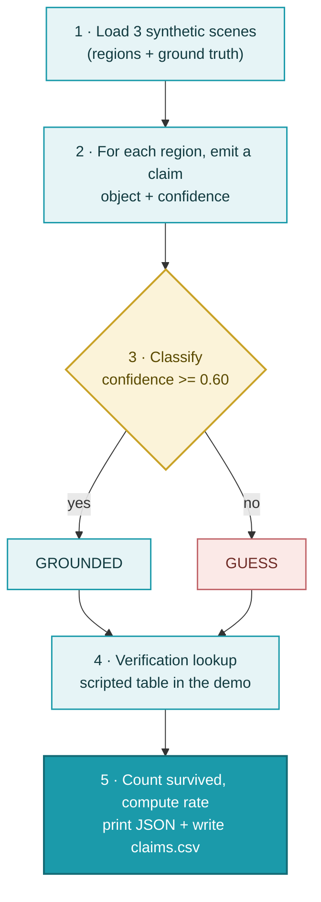
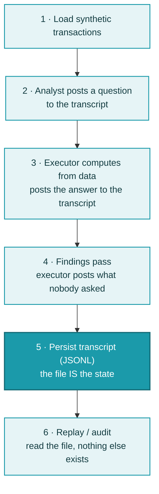
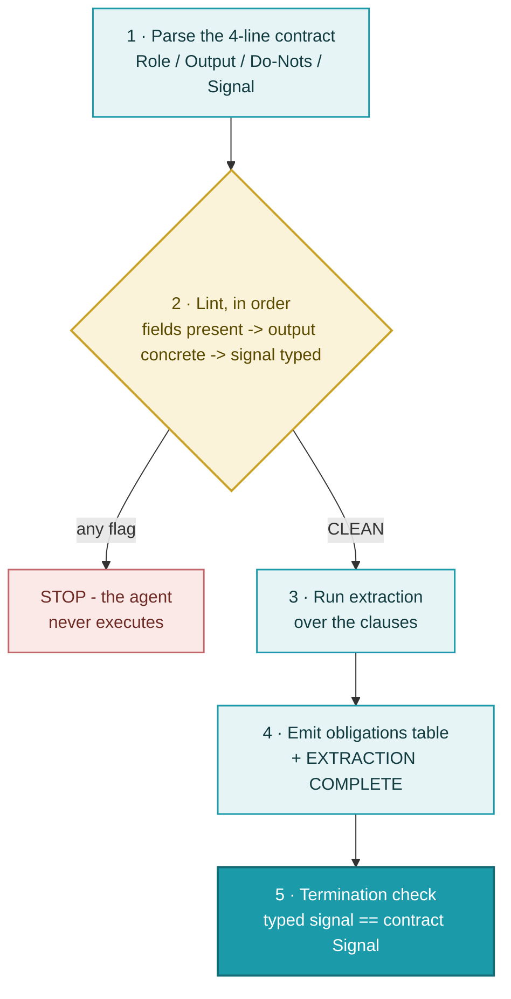

# Technical Flows — POC Learning Lab
▸ GAI OBSERVE LLC · POC LEARNING LAB — execution order, 2026-10-26
*The companion to CONCEPT-DIAGRAMS.md: those show what the concepts ARE
(context); these show what RUNS, in what order (execution). Design rule
for the whole lab: the shortest honest pipeline — one pass, no hidden
state, standard library only.*

## 01 · sees.py — execution order

Simplicity notes: single pass over 13 regions; deterministic (same
input, same output, every run); the verification step is the ONLY part
that changes when a live model + human checkers replace the stub.

## 02 · conversation.py — execution order

Simplicity notes: 12 messages total; agents share no memory — every
handoff is a transcript line, so the audit step (6) needs no tooling
beyond reading the file the run already wrote.

## 03 · rods_agent.py — execution order

Simplicity notes: the lint runs BEFORE any agent work and its order is
fixed — a contract fails at the first broken rule, so the fix is always
the earliest flag. Termination compares a typed signal, not text.
