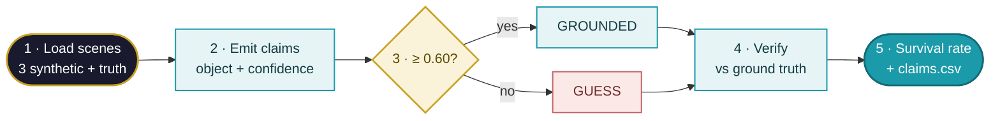
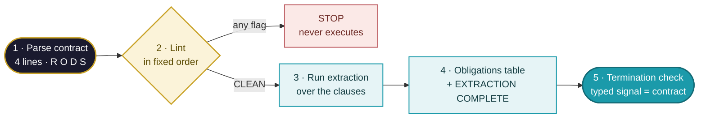
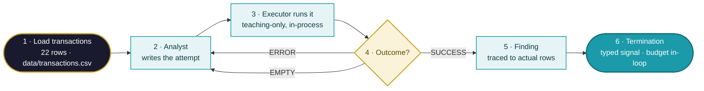
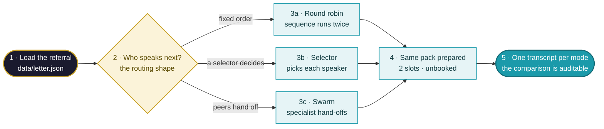

# Technical Flows — POC Learning Lab
▸ GAI OBSERVE LLC · POC LEARNING LAB — execution order, 2026-10-26
*The companion to CONCEPT-DIAGRAMS.md: those show what the concepts ARE
(context); these show what RUNS, in what order (execution). Design rule
for the whole lab: the shortest honest pipeline — one pass, no hidden
state, standard library only.*

**Visual standard (all lab flows, both families):** left-to-right —
execution reads across the page, not down its margin; generous
spacing (node 28 / rank 44) so no label touches its neighbour; a
label budget of two short lines per node, the step number first;
one palette — navy = start/deliverable · teal = process · gold =
decision · strong teal = the headline step · rose = the stopped
path. Start and end nodes are rounded; decisions are diamonds with
the test only, never a paragraph.

## 01 · sees.py — execution order

Simplicity notes: single pass over 13 regions; deterministic (same
input, same output, every run); the verification step is the ONLY part
that changes when a live model + human checkers replace the stub.

## 02 · conversation.py — execution order

```mermaid
%%{init: {"flowchart": {"nodeSpacing": 28, "rankSpacing": 44, "padding": 12}}}%%
flowchart LR
    A(["1 · Load data<br/>synthetic transactions"]):::io --> B["2 · Analyst asks<br/>posts to transcript"]:::proc
    B --> C["3 · Executor answers<br/>computed from data"]:::proc
    C --> D["4 · Findings pass<br/>what nobody asked"]:::proc
    D --> E(["5 · Transcript saved<br/>the file IS the state"]):::metric
    E --> F["6 · Replay / audit<br/>read the file only"]:::proc
    classDef io fill:#1A1A2E,stroke:#C9A227,stroke-width:2px,color:#FFFFFF;
    classDef proc fill:#E6F4F6,stroke:#1B9AAA,stroke-width:1.5px,color:#123B40;
    classDef metric fill:#1B9AAA,stroke:#146B76,stroke-width:2px,color:#FFFFFF;
```

Simplicity notes: 12 messages total; agents share no memory — every
handoff is a transcript line, so the audit step (6) needs no tooling
beyond reading the file the run already wrote.

## 03 · rods_agent.py — execution order

Simplicity notes: the lint runs BEFORE any agent work and its order is
fixed — a contract fails at the first broken rule, so the fix is always
the earliest flag. Termination compares a typed signal, not text.

## 04 · analyst_executor.py — execution order

Simplicity notes: five attempts, one pass, no hidden state — every
attempt is written to runs/attempts.csv and the summary line is computed
from that file, so the transcript a reader sees is the run that
happened. The termination budget is checked inside the loop, not after
it: a capped run stops mid-loop and says so.

## 05 · group_chat.py — execution order

Simplicity notes: same input, same three specialists, same pack —
only who-speaks-next changes, so the counted mechanics in
runs/routing-comparison.csv isolate the shape. Selector and swarm run
under an enforced turn cap: a router that can never finish ends
INCOMPLETE instead of looping.

## 06 · debate.py — execution order

Simplicity notes: one pass per claim; the verdict and the balance are
computed from the two strength totals and written to runs/verdicts.csv.
The scripted advocates argue only what they were given — the balance
map allocates human review, it is not a decision and not a risk
register.
