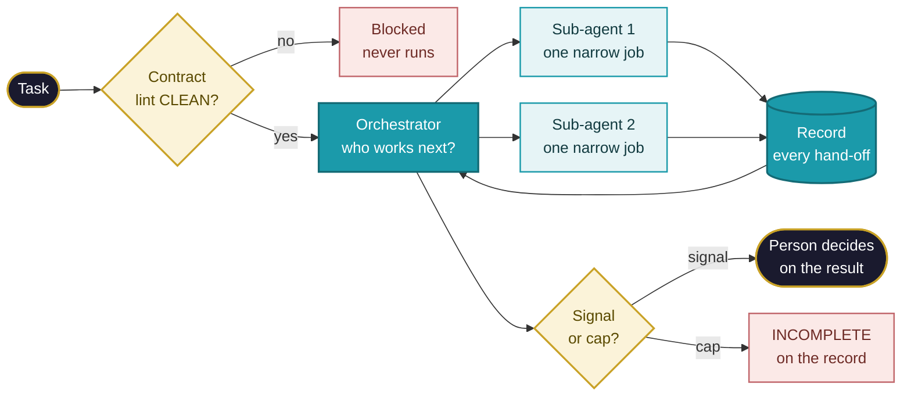

▸ GAI OBSERVE LLC · POC LEARNING LAB
# The Sub-Agent Pattern — An Introduction from POCs 01–06

*DRAFT for learners, 2026-11-19. Everything here is taught from the six Month 1
builds. They are scripted demonstrations over synthetic data (mode INTERIM,
figures ILLUSTRATIVE). No live model ran in Month 1.*

## 1. The idea in one line
Split a job into small agents with narrow roles. Give one of them the job of
deciding who works next. Make every hand-off visible.

**In plain words:** a team, not a genius. One person runs the meeting. Everyone
else does one thing well. The minutes are the memory.

## 2. Orchestrator and sub-agents
- **Orchestrator.** Decides what happens next. It does not do the specialist work.
- **Sub-agent.** Does one narrow job and reports back in a fixed shape.
- **Record.** Where every hand-off is written down.

You have already met all three in Month 1:

| Month 1 build | Orchestrator | Sub-agents | Record |
|---|---|---|---|
| POC 05 · selector | The chair (`choose_next`) | Summariser, Matcher, Scheduler | One transcript per mode |
| POC 04 · loop | The Analyst (decides the next attempt) | The Executor | Transcript; `attempts.csv` |
| POC 06 · debate | The Judge (fixed rule) | Proponent, Opponent | `debate-01.jsonl`; `verdicts.csv` |
| POC 02 · conversation | The Analyst (asks) | The Executor (answers) | `transcript-01.jsonl` |
| POC 03 · RODS | — (one agent) | The clause analyst | Run log ending on the signal |
| POC 01 · sees | — (one agent) | Parser, flagger, verifier as steps | `run-01.json` |

Read it as: the contract gate (POC 03) decides whether the team may start. The
orchestrator (POC 05's chair) decides who speaks. The record (POC 02's
transcript) is the memory. The signal and the cap (POC 03, 04, 06) decide when
it ends. A person decides what happens with the result (POC 01, 05, 06).

## 3. Four ways to decide who works next
POC 05 ran the same three specialists three ways. POCs 04 and 06 add two more shapes.

| Shape | Who decides | Seen in | Strength | Watch for |
|---|---|---|---|---|
| Fixed order | Nobody; a list | POC 05 round robin | Predictable | Spends turns whether needed or not (6 turns in the demo) |
| Chair | A selector reads the state | POC 05 selector | Direct path (3 turns) | Pays a routing call every turn, including the stop check (4 calls) |
| Peer hand-off | Each agent names the next | POC 05 swarm | Few calls (4) | Needs a verification hand-back; harder to trace |
| Loop | The caller retries on typed outcomes | POC 04 | Errors become instructions | Needs a cap; scripted here |
| Adversarial | A judge with a rule fixed first | POC 06 | Both sides on the record | Closest fight is a prompt, not a measurement |

*Counts are the mechanics of the Month 1 scripts. They are not costs.*

## 4. Hand-offs
A hand-off is a message one agent writes and another reads. Month 1 used three kinds:
- **Transcript lines** (`kit/transcript.py`): `turn, speaker, kind, content`. Used in 02, 04, 05, 06.
- **Shared state** (POC 05's `state` dict): fast, but any agent can overwrite any field.
- **Typed signals** (`kit/termination.py`): `EXTRACTION COMPLETE`, `ANALYSIS COMPLETE`, `DEBATE COMPLETE`. Exact match only. "done" is not a signal.

**Rule of thumb:** if the next agent must branch on it, make it a typed string.

## 5. Context boundaries
A context boundary is what a sub-agent is allowed to see.
- **POC 02:** the Executor sees a copied export, never live bank access.
- **POC 04:** the Executor sees only `rows` and seven builtins. This is a *teaching* boundary. It is **not** an isolation boundary. Production needs a separate process or container.
- **POC 05:** the specialists see the whole shared `state`. That is a wide boundary; Month 1 accepts it for teaching.
- **POC 03:** the Do-Nots line is a boundary written in words, checked for presence by the linter.

**Question to ask of every sub-agent:** what can it read, what can it write,
and what must it never do?

## 6. Evaluation
Month 1 evaluated each build in a way a second person can repeat:

| Method | Build | What it shows |
|---|---|---|
| Survival rate | 01 | How many claims withstand a check |
| Lint before run | 03 | The contract is complete before anything runs |
| Typed outcomes | 04 | Which failures were code and which were questions |
| Comparison table | 05 | What each routing shape spent, from the run records |
| Disagreement score | 06 | Where a person should look first |
| Perturbation tests | all six | Change the data; the figure must move |
| Audit from the record | 02, 05 | Re-count from the saved transcript alone |

**The Month 1 lesson on evaluation:** if you cannot move a figure by changing
the data, someone typed it in.

## 7. Failure modes, and where Month 1 meets them

| Failure mode | What it looks like | Month 1 control | Where |
|---|---|---|---|
| Runaway loop | The agents never stop | Turn cap | 04, 05, 06 (`kit/termination.py`, `MAX_TURNS`) |
| Accidental ending | A prose word ends the run | Exact typed signal; `WEAK_SIGNAL` lint | 03 |
| Vague output | Downstream cannot parse it | `VAGUE_OUTPUT` lint; fixed table | 03 |
| Duplicate contract field | A later line silently overwrites | Parser raises an error | `kit/rods.py` |
| Silent wrong answer | Empty result treated as "nothing found" | EMPTY is its own outcome | 04 |
| Finding from code that never ran | A summary cites a result that did not happen | Finding drawn only from executed attempts | 04 |
| Hidden guess | A confident caption hides doubt | GUESS flag below a fixed line | 01 |
| Plausible output from a broken route | A capped run still fills a field | Read the termination record, not just the output | 05 (chain 4) |
| Divide by zero in a score | No arguments on either side | Score returns 0 | 06 |
| Agent acts without consent | A booking or a signature | Human gate | 05, 06 |
| Teaching sandbox used for real | Untrusted code in-process | Labelled not an isolation boundary | 04 |

## 8. Your first sub-agent, as a checklist
1. Write its RODS contract: Role, Output (a table, schema or JSON), Do-Nots, Signal.
2. Run `kit/rods.py` lint. Fix every flag.
3. Name what it can read and what it can write.
4. Give it a signal and a cap (`kit/termination.py`).
5. Make it write to the transcript (`kit/transcript.py`).
6. Decide who orchestrates it: a list, a chair, a peer, a loop or a judge.
7. Decide where a person steps in.
8. Write one perturbation test: change its input, watch its output move.
9. Label everything ILLUSTRATIVE until a real, recorded run says otherwise.

## Glossary
- **Orchestrator** — the agent or rule that decides who works next.
- **Sub-agent** — an agent with one narrow job and a fixed output shape.
- **Hand-off** — a message passed from one agent to the next.
- **Context boundary** — what a sub-agent may see and change.
- **Typed signal** — an exact string that ends a run.
- **Cap** — the most turns a run may take.
- **INTERIM / FINAL** — scripted stub vs a live, recorded, reproducible run (`ROADMAP.md`).
- **ILLUSTRATIVE / MEASURED** — a worked example vs a figure from a real recorded run.
